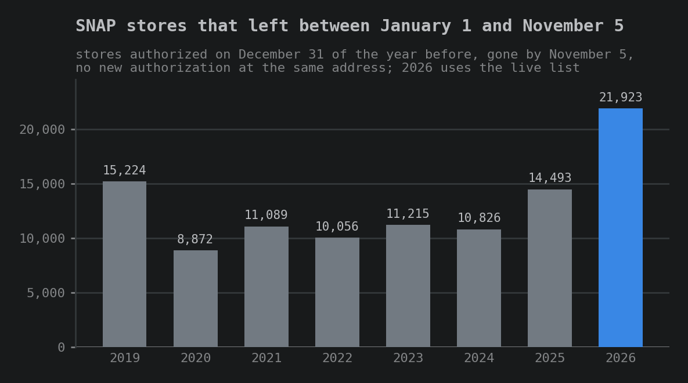
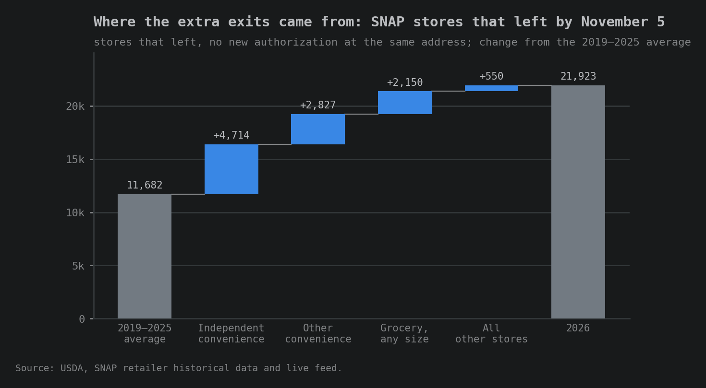
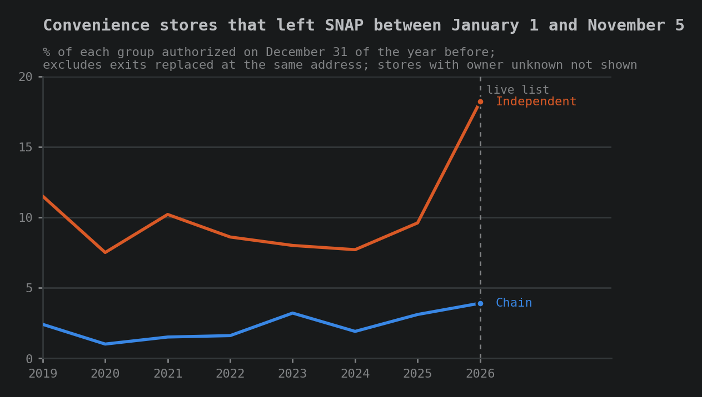
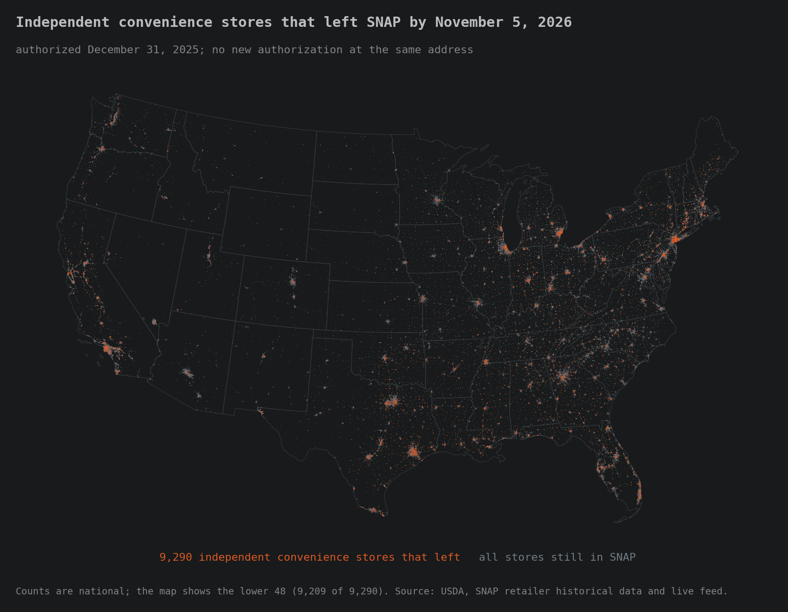
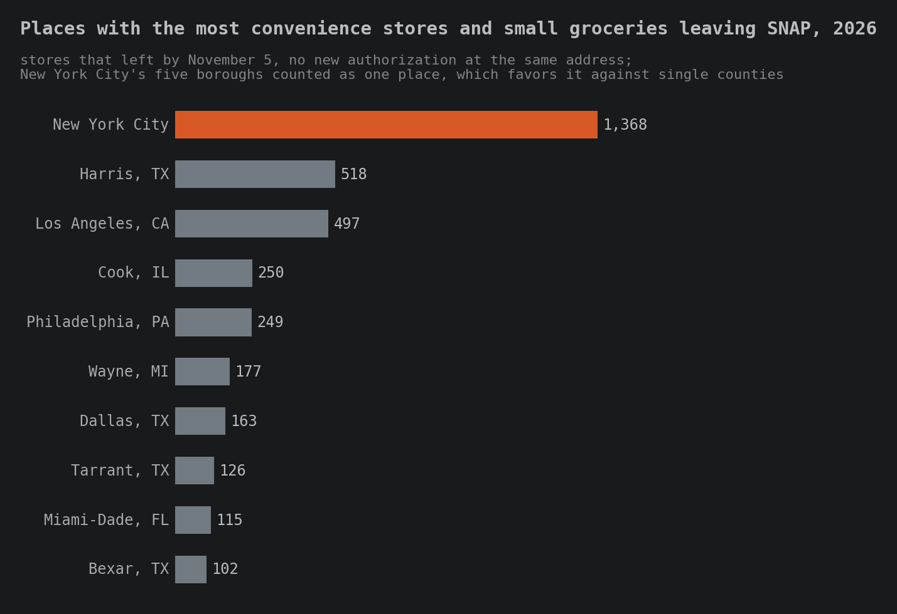
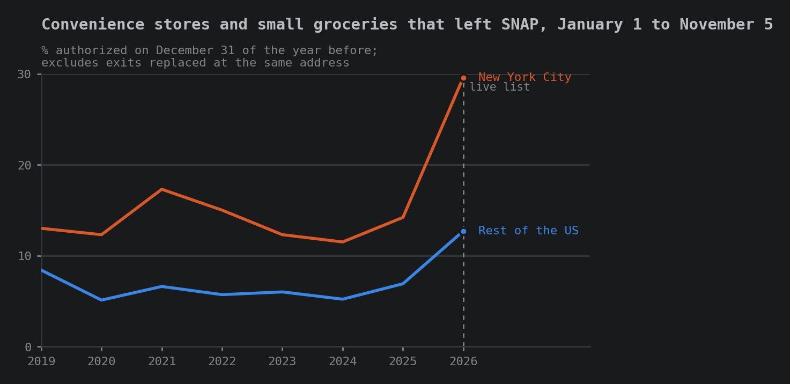
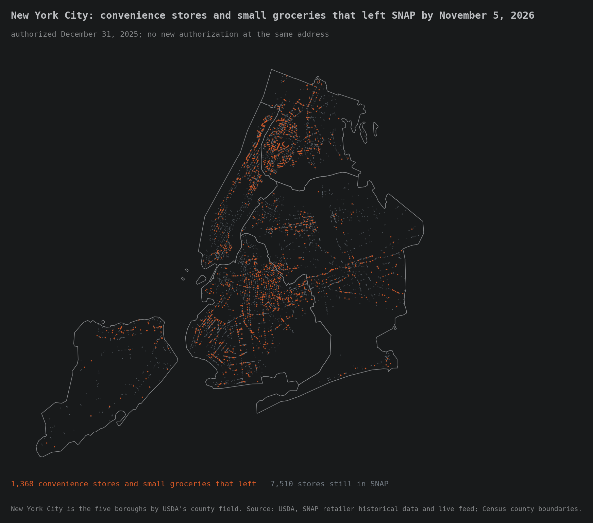
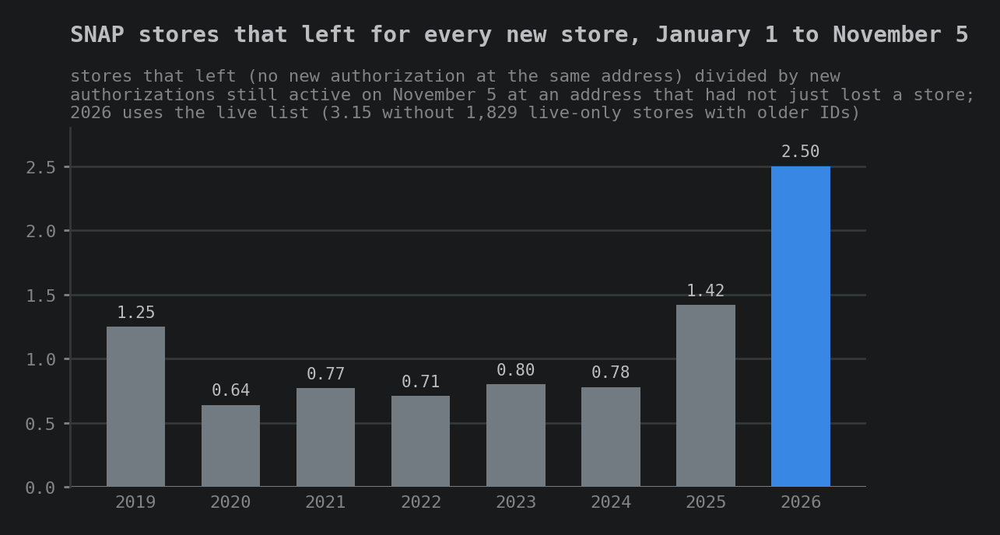
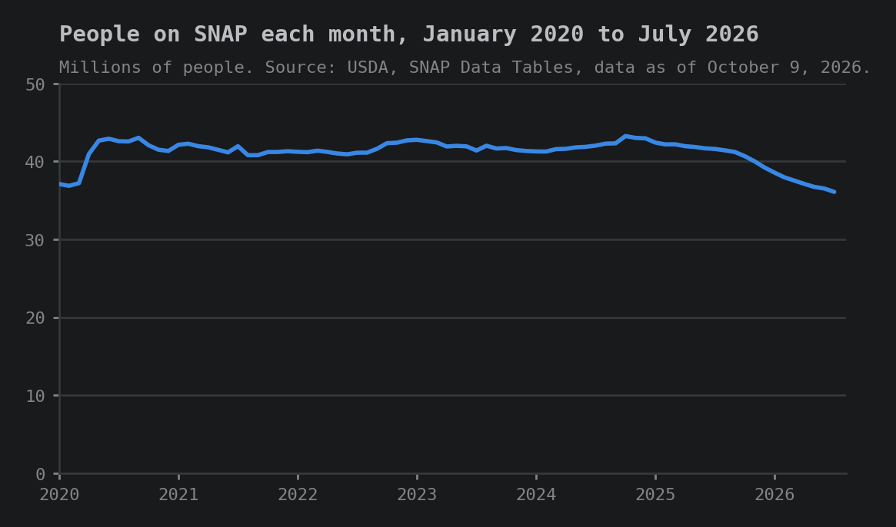
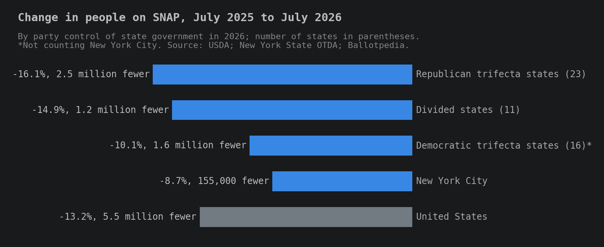

# SNAP stores were leaving before the stocking rule arrived

On August 28, we asked what would happen to SNAP stores when the new stocking rule took effect. Maybe nothing. Maybe SNAP-authorized retail would be cut by a third. We said we would track USDA's retailer list after the rule landed and report what changed.

The rule took effect on November 4. Here is what it requires:

- Seven varieties of food in each of four staple groups: dairy, grains, protein, and fruits or vegetables.
- Three stocking units of each variety, for at least 84 items, up from 36.
- Perishable foods in at least three of the four groups.
- Existing stores are checked mainly when they come up for reauthorization, which generally happens every five years. USDA can check any store at any time.

USDA estimated that about 5,000 stores could be denied under the new standard, and that about 500 of them would not come back.

It turns out that was the wrong question. While we were writing about the data through 2025, stores were already leaving SNAP faster than usual. So we checked USDA's list again.

A note on how we count. A store **left SNAP** if it was authorized on December 31 of the year before and was gone from USDA's list by November 5, with no new authorization at the same address. A store that changed owners and got a new record number is not counted. We compare every year from 2019 to 2026 over the same window, January 1 to November 5.

## The exits

::: spacer 5px

In 2026, 21,923 stores left SNAP by November 5. That is 8.8% of the stores authorized at the start of the year. In 2020 through 2024, between 8,872 and 11,215 stores left over the same months. The number started climbing in 2025, to 14,493.

*Source: USDA Food and Nutrition Administration, SNAP retailer historical data and live retailer list.*

The 2019 to 2025 average is 11,682 exits. The next chart shows where the 2026 rise above that average came from, by type of store. Independent convenience stores added the most, 4,714 exits above their own average. Chain and other convenience stores added 2,827, and grocery stores added 2,150. Every other type of store combined added 550.

*Each bar is a store type's 2026 exits minus its own 2019 to 2025 average. Source: USDA.*

## Independent convenience stores

::: spacer 5px

An independent store here is one whose name appears on four or fewer SNAP stores. In 2026, 9,290 independent convenience stores left SNAP. That is 18.2% of those authorized on December 31, 2025. In 2019 through 2025, that share ranged from 7.7% to 11.5%. Chain convenience stores rose too, but from a much lower level: 3.9% in 2026, against 1.0% to 3.2% before. The chart below shows both.

*Stores whose owner could not be identified are not shown. Source: USDA.*

The map shows where those 9,290 stores were. They are spread across the country, and many are in large metro areas.

*Source: USDA.*

## New York City

::: spacer 5px

No place lost more convenience stores and small groceries from SNAP than New York City. The chart below ranks the places with the most exits of those two store types. New York City had 1,368. Harris County, Texas, was next, with 518.

*New York City's five boroughs are counted as one place, which favors it against single counties. Source: USDA.*

New York City holds 3.7% of the country's SNAP convenience stores and small groceries. It accounts for 8.2% of the ones that left in 2026, and 14.2% of all small groceries that left. As the next chart shows, 29.6% of the city's SNAP convenience stores and small groceries left by November 5. Between 2019 and 2025, that share ranged from 11.5% to 17.3%. In the rest of the country it was 12.7% in 2026.

*Source: USDA.*

The map shows the 1,368 stores across the five boroughs. Many are in the Bronx, northern Manhattan and central Brooklyn.

*Source: USDA; Census Bureau county boundaries.*

## Places left with one store, or none

::: spacer 5px

Hayes County, Nebraska had one SNAP store at the start of 2026: Scott's Grocery in Hayes Center. A store at that address had been in SNAP under three record numbers since 1977. It was on USDA's list on December 31, 2025. It was not on the list on November 5.

Hayes County is one of ten counties where the count of SNAP stores fell to one or none, or was cut in half:

- **No store left:** Hayes County, Nebraska (1 to 0) and Harding County, New Mexico (1 to 0). A farmers market in Harding County is still authorized.
- **Down to one store:** Oliver County, North Dakota (3 to 1); Echols County, Georgia (2 to 1); Essex County, Vermont (2 to 1); Foard County, Texas (2 to 1).
- **Cut in half:** Bowman County, North Dakota; Gilpin County, Colorado; Motley County, Texas; and Warren County, Indiana, each from 4 stores to 2.

Across the country, 22 counties now have no SNAP store, up from 21 on December 31. Thirty-seven have exactly one, up from 35.

## Fewer stores coming in

::: spacer 5px

Exits are only half of the picture. New stores join SNAP every year, and in a normal year they more than make up for the ones that leave. The chart below divides the stores that left by the new stores that joined over the same months. In 2020 through 2024, between 0.64 and 0.80 stores left for every new one. In 2025, it was 1.42. In 2026, it was 2.50.

*New stores at the address of a store that left are not counted, because that exit is not counted either. Source: USDA.*

The 2026 ratio rose on both sides. Exits went up, and new stores went down, from about 14,000 a year in 2020 through 2024 to 8,778 in 2026.

## Why are so many stores leaving?

::: spacer 5px

The data shows which stores left and where. It cannot show why. Several things changed for SNAP stores at about the same time, and any of them could be part of it:

- **State limits on buying soda and candy with SNAP.** Ten states had these limits in effect at some point in 2026. In those states, 15.1% of convenience stores left SNAP by November 5, compared with 11.7% in the other states and DC. In 2019 to 2025, the average was about 6% in both. A peer-reviewed study of the same USDA list, by Chrisinger and White in Health Affairs Scholar (October 2026), found about 1.4% fewer convenience stores in SNAP in states with the limits than would have been expected. That is a real difference, but smaller than the rise we see, and the rise happened in states without limits too.
- **Fewer people on SNAP.** The July 2025 budget law changed who qualifies for SNAP. USDA's numbers show 36.1 million people on SNAP in July 2026, down 13.2% from July 2025. Enrollment fell 16.1% in states where one party, Republican, controls the governor's office and both chambers of the legislature, 14.9% in states where control is divided, and 10.1% in states where Democrats control all three, not counting New York City. A few large drops move these averages. Texas and Florida fell about 20%. Arizona, a divided state, fell 50.8%, the largest drop of any state. We will look at Arizona in a later post. In New York City, where stores left at the highest rate, enrollment fell 8.7%, less than the national drop. Fewer SNAP shoppers would mean less SNAP business for stores, and USDA's own analysis says stores with the lowest SNAP sales may be the most likely to drop out.
- **Stores leaving ahead of the stocking rule.** The rule was published on May 8, and USDA's guidance came in September. Some stores may have decided not to restock and left early. The data cannot test this.
- **USDA enforcement.** USDA could have removed more stores for rule violations. We did not test this.

The chart below shows the number of people on SNAP each month since January 2020.

*Source: USDA, SNAP Data Tables, data as of October 9, 2026. Pandemic school-meal benefits (P-EBT) are not counted.*

The next chart shows the change in enrollment from July 2025 to July 2026, by which party controls state government.

*Source: USDA, SNAP Data Tables, data as of October 9, 2026; New York State Office of Temporary and Disability Assistance for New York City; Ballotpedia for party control.*

We cannot know which of these matter most, or prove any of them. But the data is the data. About 22,000 stores left SNAP in ten months, nearly all of it before the November 4 compliance date. If we care about SNAP, we have to pay attention to this.

::: divider

## How we did this

::: spacer 5px

**Data.** USDA's SNAP retailer historical file, which lists every authorization through December 31, 2025, and USDA's live retailer list, saved on November 5, 2026. The live list is replaced every time USDA updates it, so our saved copy is the only record of that day. Enrollment figures come from USDA's SNAP Data Tables, data as of October 9, 2026, and, for New York City, New York State's SNAP caseload data.

**What counts as an exit.** A store authorized on December 31 of the year before that is gone from the list by November 5, with no new authorization at the same street address and ZIP code. Earlier years use the historical file on both dates. 2026 uses the historical file on December 31 and the live list on November 5.

**New stores.** Stores on the list on November 5 that were not authorized on the December 31 before, not counting new stores at the address of a store that left.

**Independent and chain.** We match store names to chains. A name on four or fewer SNAP stores counts as independent.

**Counties.** Stores are placed in counties by their map coordinates, using Census Bureau county boundaries.

**Limits.**

- An exit is a lost SNAP authorization. It does not tell us whether a store closed, chose to leave, or was removed.
- 2026 is measured with a different source on November 5 than earlier years. The largest chains changed little, which suggests the switch is not creating exits on its own, but we cannot rule out that USDA leaves some authorized stores off its public list.
- Some exits USDA recorded late in 2025 may show up in our 2026 count. Adjusting for that would lower the 2026 convenience store rate from 12.5% to about 11.6%.
- About 1,800 stores newly on the 2026 list carry older record numbers and may not be new. Without them, the 2026 ratio of exits to new stores would be 3.15, not 2.50.

Code, data notes and checks: [Data4ThePeople/SNAP_Locations](https://github.com/Data4ThePeople/SNAP_Locations).
